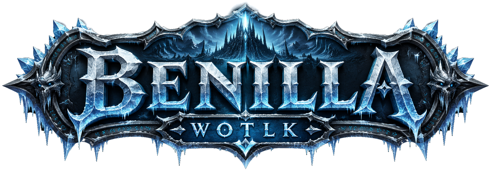

<p align="center">
  
</p>

# Benilla-Wotlk

Benilla-WotLK is an effort to preserve and recreate the original Wrath of the Lich King client experience using a modern, independently developed game engine.

Originally based on the [Benilla](https://github.com/samwhosung/benilla) project, which targets World of Warcraft 1.12.1, Benilla-WotLK has since evolved into a standalone project focused exclusively on version 3.3.5a (build 12340).

The client connects to compatible 3.3.5a servers using the original network protocol, loads game assets from your own WotLK installation, and runs the original interface directly from those files. The rendering engine, file format support, networking, and UI runtime are independently implemented in Rust, with the original 3.3.5a client serving as the behavioral reference.

This project does not distribute Blizzard's original client code or game assets. Users must provide their own game data.

## Status

> [!IMPORTANT]
> The 3.3.5a port is in progress. The client can authenticate, enter the world, and run the stock
> 3.3.5a interface, but parts of the data and gameplay layers still use 1.12.1 layouts or behavior.

Other client versions are not planned. Warden will come later. Use a 3.3.5a server with
Warden disabled for now.

## Highlights

- **Formats:** readers for the MPQ patch chain, BLP, DBC, ADT, WDT, WDL, M2, and WMO, exposed to
  Bevy as an asset source.
- **World:** streamed terrain, portal-culled buildings with interior lighting, doodads, ground
  clutter, swimmable water, sky, weather, and reference-style day/night lighting, fog, and gamma.
- **Models:** GPU-skinned M2 models with animation, particles, ribbons, spell visuals, character
  customization, armor compositing, weapons, enchant glows, forms, stealth, and mounts.
- **Movement:** bidirectional networked movement, server-granted movement modes, camera collision,
  transports, and taxi flights.
- **Networking:** SRP6 authentication, world-session crypto, and an ECS object mirror covering
  movement, chat, combat, spells, groups, raids, quests, trade, mail, auctions, and battlegrounds.
- **Interface:** a FrameXML and Lua engine that runs the stock 3.3.5a interface and third-party
  addons from the player's installation and local configuration.
- **Audio:** music, ambience, and effects with selection and crossfade rules, interior and
  underwater transitions, and zone reverb.

The format readers and UI engine core are plain Rust without Bevy. The world renderer can also run
without the game attached. See [`docs/MAP.md`](docs/MAP.md) for the generated map of crates,
subsystems, instruments, and scripts.

## Requirements

- An English World of Warcraft 3.3.5a client installation (build 12340). Benilla reads it but never
  writes to it.
- A 3.3.5a server with Warden disabled. Development uses
  [AzerothCore](https://github.com/azerothcore/azerothcore-wotlk).
- Stable Rust and a C compiler because the vendored Lua runtime is built from source.
  - Windows: the MSVC build tools selected by the Rust installer.
  - Linux: ALSA and udev development packages, plus `pkg-config`.
  - macOS: Xcode Command Line Tools.

## Quick start

Clone the repository, point `WOW_DATA` at the `Data` directory of your 3.3.5a installation, and
run `cargo play`. It builds the player binary and starts it; the first build takes a while.

### Windows PowerShell

```powershell
git clone https://github.com/Onixaz/benilla-wotlk.git
Set-Location benilla-wotlk
$env:WOW_DATA = "C:\Games\World of Warcraft 3.3.5a\Data"
cargo play
```

### Linux and macOS

```sh
git clone https://github.com/Onixaz/benilla-wotlk.git
cd benilla-wotlk
WOW_DATA=/path/to/WoW/Data cargo play
```

`cargo ship` builds the release binary, with fat link-time optimization and without a profile,
into `target/release/` without starting it. The binary is self-contained and can be copied anywhere. Instead of setting `WOW_DATA`, you can put a `WoW` link
beside the binary that points to the installation directory:

```powershell
New-Item -ItemType Junction -Path target\release\WoW -Target "C:\Games\World of Warcraft 3.3.5a"
```

```sh
ln -s /path/to/WoW target/release/WoW
```

### Releases

[GitHub Releases](../../releases) carry the `cargo ship` binary for Windows and Linux, each in an
archive with the licenses and `THIRD-PARTY-LICENSES.txt`, the notices of the open-source code
inside it. To cut one, bump the version on a branch and land it:

```sh
scripts/release/bump.sh minor   # or major, patch, X.Y.Z; commits "Release vX.Y.Z"
```

When the new version reaches `main`, `.github/workflows/release.yml` builds both platforms and
publishes release `vX.Y.Z`, creating the tag on that commit.

### Faster with a profile

`cargo play` reads a profile of how the game runs on your machine when you have recorded one, and
builds with profile-guided optimization (PGO): about 20% more frames per second. The repository
does not ship a profile; record one once:

```sh
rustup component add llvm-tools
scripts/pgo-train.sh
cargo play
```

`scripts/pgo-train.sh` builds an instrumented copy of `cargo play`'s client and starts it: log in,
play a few minutes through busy places such as a city or a fight, then quit the game normally. It
writes the profile to `benilla-config/pgo/`, replacing the last one, and the next `cargo play`
rebuilds with it, about 25 minutes of building for the two. `cargo play` says whether it built
with a profile. Record a new one after a Rust toolchain update. See
[`docs/CONTRIBUTING.md`](docs/CONTRIBUTING.md).

For the last few percent, set `BENILLA_PGO_LTO=fat` for both commands. They then use fat link-time
optimization (LTO), with a profile of its own, which measures 3–7% less frame time than the
default thin LTO at Acherus. Each build takes about three times as long, about an hour of building
for the first run. In PowerShell, set `$env:BENILLA_PGO_LTO = "fat"` first.

```sh
BENILLA_PGO_LTO=fat scripts/pgo-train.sh
BENILLA_PGO_LTO=fat cargo play
```

### Development build

`cargo dev` (or `cargo debug`) builds and runs the development build: incremental, with debug
assertions and the developer instruments compiled in, so it is the one to work on Benilla with and
not the one to play on. It also finds a `WoW` link at the repository root. See
[`docs/CONTRIBUTING.md`](docs/CONTRIBUTING.md).

## Configuration

| Setting | Purpose |
| --- | --- |
| `WOW_DATA` | Path to the installation's `Data` directory. |
| `WOW_HOST` | Authentication endpoint; defaults to `localhost:3724`. A hostname or `host:port` is accepted. |
| `WOW_USER` and `WOW_PASS` | Optional credentials for automatic login. Set both or use the login screen. |
| `WOW_CHAR` | Optional character name for automatic selection. |

Player settings, screenshots, logs, and addons live under `benilla-config/` beside the binary
(`target/play/benilla-config/` for `cargo play` and the training run,
`target/release/benilla-config/` for `cargo ship`), or at the repository root for `cargo dev`.
Place addons in `benilla-config/AddOns/`.

## Documentation

- [`docs/METHOD.md`](docs/METHOD.md) defines the reference-first development method and safety
  rules.
- [`docs/MAP.md`](docs/MAP.md) is the generated map of what is currently implemented.
- [`docs/CONTRIBUTING.md`](docs/CONTRIBUTING.md) covers development setup, validation, and pull
  requests.

Issues and pull requests are welcome. Bugs, questions, and ideas can also be discussed on
[Discord](https://discord.gg/wJSJx467G4).

## Acknowledgements and legal

The project builds upon the original [Benilla](https://github.com/samwhosung/benilla) client and acknowledges the work of its original author and contributors.

Benilla-Wotlk is an independent fan project and is not affiliated with or endorsed by Blizzard
Entertainment. It ships no assets extracted from World of Warcraft: no models, sounds, maps, MPQ
contents, or FrameXML. You must provide your own legally obtained 3.3.5a installation. The files
under `crates/benilla-app/assets/ui/` are project-owned adapters and interface elements, not copies
from the game.

World of Warcraft is a trademark of Blizzard Entertainment, Inc. Benilla-Wotlk code is available under
your choice of the [MIT](LICENSE-MIT) or [Apache 2.0](LICENSE-APACHE) license. Vendored components
under `third_party/`, including the Kira audio engine and Lua 5.1, retain their own licenses.
